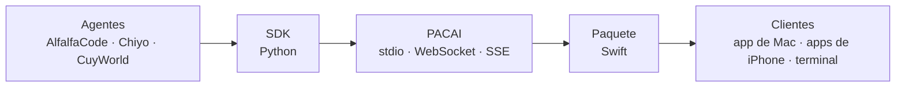
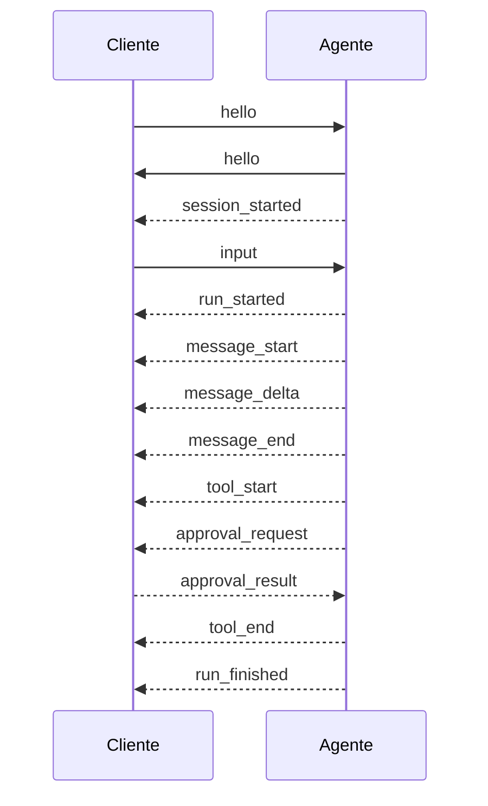

# PACAI

**Protocol for Agent Communication And Interfaces.** Un idioma común entre agentes (AlfalfaCode, Chiyo, el director de juego de CuyWorld…) y los clientes que los muestran: apps de Mac y móvil, widgets, terminales, webs y voz.

> Estado: **0.2 cerrada** en lo técnico, con licencia Apache-2.0. El repo es privado hasta comprobar el nombre (anexo B de la especificación).

## Qué es PACAI

PACAI es el protocolo con el que un agente habla con la app que lo muestra: el agente decide qué decir y hacer, y el cliente decide cómo mostrarlo.

El repositorio trae:

- **La especificación**: cómo funciona el protocolo.
- **El esquema JSON**: para validar la forma de los mensajes.
- **Ejemplos y el verificador de conformidad**: para comprobar implementaciones.
- **El SDK de Python**: para construir y validar mensajes y sesiones.
- **El paquete Swift** (macOS 14 e iOS 17): para leer y escribir mensajes PACAI en esas plataformas.

## Dónde encaja PACAI



## Sesión típica



## Contenido

| Ruta | Qué es |
|---|---|
| [`spec/PACAI-0.2.md`](spec/PACAI-0.2.md) | La especificación, con identificadores en inglés y prosa en español |
| [`spec/historico/PACAI-0.1.md`](spec/historico/PACAI-0.1.md) | El borrador anterior |
| `schema/pacai-0.2.schema.json` | El esquema JSON, generado por `schema/generar.py` |
| `conformance/` | Ejemplos válidos, ejemplos inválidos y el verificador |
| `sdk/python/` | SDK de Python (paquete `pacai`) |
| `sdk/swift/` | Paquete Swift `PACAI` (macOS 14, iOS 17) |

## Comprobar

```sh
pip install jsonschema
python3 schema/generar.py                  # regenera el esquema (y su copia en sdk/python/pacai/)
python3 conformance/generar_ejemplos.py    # regenera los ejemplos válidos e inválidos por mensaje
python3 conformance/verificar.py           # todo debe salir OK
python3 conformance/verificar.py mi-sesion.jsonl
(cd sdk/python && python3 -m pytest)       # pruebas del SDK de Python
(cd sdk/swift && swift test)               # pruebas del paquete Swift
```

El verificador usa las reglas de sesión del SDK de Python (`pacai.Session`), así que los dos no pueden divergir.

## En una página

- **Un sobre por mensaje:** `pacai`, `id`, `type`, `session`, `sender`, `seq`, `time`, `reply_to` y `payload`.
- **Al empezar:** ambos lados envían `hello`, que negocia versión, perfiles, extensiones y las herramientas del cliente.
- **Trabajo:** `input` (`new_run` o `steer`) → `run_started` → `message_*` y `tool_*` → `run_finished`.
- **Subagentes:** un `run_started` con `parent_run_id` es una subejecución. Puede haber varias a la vez, se interrumpen en cascada y cierran antes que su madre.
- **Aprobaciones:** con digest JCS de los argumentos, caducidad y alcance `once` o `session`. Una aprobación `session` se reutiliza con `tool_start.approval_id`, solo para el mismo digest. El silencio nunca cuenta como un sí.
- **Reanudación:** `hello` con `resume_after_seq`; el agente reenvía lo retenido o responde con `snapshot`. Nunca relanza una ejecución terminada.
- **Perfiles opcionales:** `voice`, `shared_state`, `work` (plan y diff) y `expression` (emoción, gesto y voz del personaje).
- **Extensiones:** con espacio de nombres, como `alfalfa.budget`.
- **Transportes:** stdio (JSONL), WebSocket y SSE.
- **AG-UI:** no hace falta puente; el anexo C explica la correspondencia y qué se pierde.

## SDK de Python

Requiere Python ≥ 3.11 y solo depende de `jsonschema`. Mientras no se publique, se instala desde el repositorio:

```sh
pip install -e sdk/python            # o: PYTHONPATH=sdk/python
```

Un agente mínimo sobre stdio:

```python
from pacai import MessageBuilder, Session, StdioTransport

canal = StdioTransport()                    # stdin/stdout; los registros, por stderr
agente = None
for m in canal:                                # None en EOF, que equivale a close
    if m['type'] == 'hello':
        agente = MessageBuilder('agent', m['session'])
        canal.send(agente.hello(profiles=['work']))
        canal.send(agente.session_started(m['id'], profiles=['work']))
    elif m['type'] == 'input':
        run = agente.run_started(m['id'])
        canal.send(run)
        for parte in agente.text_message(run['id'], 'Hola.'):
            canal.send(parte)
        canal.send(agente.run_finished(run['id']))
```

Pedir permiso y comprobar el digest:

```python
from pacai import digest

herramienta = agente.tool_start(run['id'], 'run_command', {'argv': ['npm', 'test']})
peticion = agente.approval_request(herramienta, reason='policy', expires='2026-11-12T14:00:00Z',
                                   scopes=['once', 'session'])
assert peticion['payload']['digest'] == digest({'argv': ['npm', 'test']})   # JCS, RFC 8785
```

Validar mensajes y sesiones:

```python
from pacai import Session, validate

validate(mensaje)                 # lista de errores de esquema; vacía si es válido
s = Session()
for m in mensajes:
    problemas = s.feed(m)         # reglas de sesión de ese mensaje
s.finish()                        # p. ej. ejecuciones sin run_finished
s.authorized_by_session('run_command', {'argv': ['npm', 'test']})   # id de la aprobación session, o None
```

## Paquete Swift

En `Package.swift`, mientras no se publique, como dependencia local:

```swift
.package(path: "../PACAI/sdk/swift")
// y en el target: .product(name: "PACAI", package: "swift")
```

Leer y escribir JSONL, por ejemplo con el proceso `alfalfa --pacai`:

```swift
import PACAI

let writer = JSONLWriter(handle: proceso.standardInput.fileHandleForWriting)
try writer.write(Message(id: "m_00000001", session: sesion, sender: .client, seq: 1,
                         time: "2026-11-12T10:00:00Z", body: .hello(Hello(profiles: ["work"]))))

for try await mensaje in proceso.standardOutput.fileHandleForReading.pacaiMessages {
    switch mensaje.body {
    case .messageDelta(let d): print(d.blocks.compactMap(\.text).joined(), terminator: "")
    case .runStarted(let r) where r.isSubrun: print("subagente:", r.agent?.name ?? "?")
    case .approvalRequest(let p): mostrarPermiso(p)       // p.digest, p.scopes, p.expires
    case .extension(let tipo, let payload): print(tipo, payload)   // p. ej. alfalfa.budget, en crudo
    default: break
    }
}
```

Los tipos son `Codable`. Las extensiones y los tipos futuros llegan como `JSONValue`, y los campos desconocidos del sobre y del payload se conservan en `envelopeExtras` y `payloadExtras`: volver a codificar un mensaje no pierde nada. El paquete no valida contra el esquema ni aplica las reglas de sesión; eso lo hace el SDK de Python.

## Hoja de ruta

1. ~~Cerrar la 0.2: subagentes y ejecuciones en paralelo, y la correspondencia con AG-UI.~~ Hecho.
2. ~~SDK de Python y paquete Swift.~~ Hecho; los tipos están escritos a mano y las pruebas los contrastan con los ejemplos de `conformance/`.
3. ~~Elegir la licencia.~~ Apache-2.0, como MCP. Falta decidir el nombre (marcas, repositorios y dominios) y publicar el repositorio.
4. `alfalfa --pacai`, que sustituye a `--stdio` v2 (ver el anexo A de la especificación).
5. La app de Mac de AlfalfaCode sobre PACAI, con el paquete Swift.
6. El director de juego de CuyWorld sobre PACAI.

## Licencia

PACAI (la especificación, el esquema, los ejemplos de conformidad y los SDK de Python y Swift) se
publica bajo la [Apache License 2.0](LICENSE): se puede usar, modificar y redistribuir libremente,
también en productos cerrados, conservando el aviso de [NOTICE](NOTICE). Incluye una concesión de
patentes de quien aporta código. Es la misma licencia que usa MCP para su especificación y su código
nuevo.
