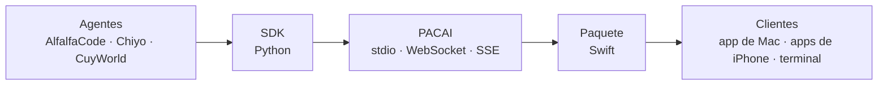
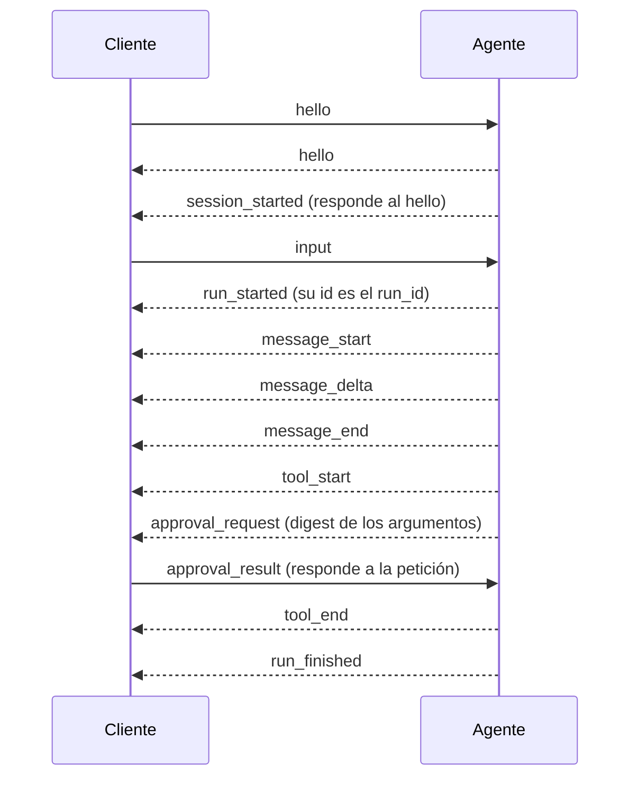
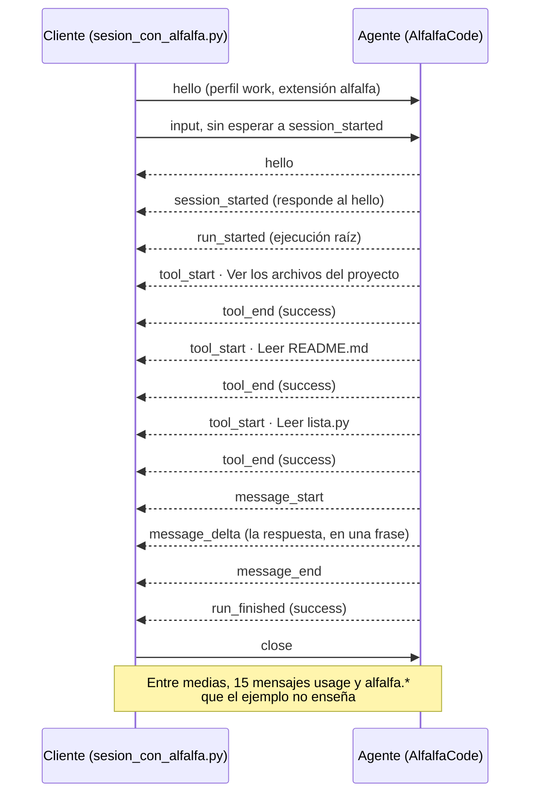

# PACAI

**Protocol for Agent Communication And Interfaces.** Un idioma común entre agentes (AlfalfaCode, Chiyo, el director de juego de CuyWorld…) y los clientes que los muestran: apps de Mac y móvil, widgets, terminales, webs y voz.

> Estado: **0.3 cerrada** en lo técnico, con licencia Apache-2.0. Sale de implementar la 0.2 en AlfalfaCode; los cambios están en el §11 de la especificación. El repo es privado hasta comprobar el nombre (anexo B de la especificación).

## Qué es PACAI

PACAI es el protocolo con el que un agente habla con la app que lo muestra: el agente decide qué decir y hacer, y el cliente decide cómo mostrarlo.

El repositorio trae:

- **La especificación**: cómo funciona el protocolo.
- **El esquema JSON**: para validar la forma de los mensajes.
- **Ejemplos y el verificador de conformidad**: para comprobar implementaciones.
- **El SDK de Python**: para construir y validar mensajes y sesiones.
- **El paquete Swift** (macOS 14 e iOS 17): para leer y escribir mensajes PACAI en esas plataformas.

## Dónde encaja PACAI



## Sesión típica

El usuario pide borrar una carpeta. El agente lo anuncia, pide permiso para la orden, la ejecuta y termina. Flecha continua: lo envía el cliente; discontinua: el agente.



Así viaja esa misma sesión por stdio, un mensaje JSON por línea. Es el ejemplo [`conformance/valid/18-sesion-tipica.jsonl`](conformance/valid/18-sesion-tipica.jsonl), que el verificador comprueba; `conformance/generar_ejemplos.py` reescribe este bloque.

<!-- sesion-tipica:inicio -->
```jsonl
{"pacai": "0.3", "id": "m_00000001", "type": "hello", "session": "s_ejemplo_0123456789abcdef", "sender": "client", "seq": 1, "time": "2026-11-12T10:00:01Z", "payload": {"versions": ["0.3"], "profiles": [], "extensions": []}}
{"pacai": "0.3", "id": "m_00000002", "type": "hello", "session": "s_ejemplo_0123456789abcdef", "sender": "agent", "seq": 1, "time": "2026-11-12T10:00:02Z", "payload": {"versions": ["0.3"], "profiles": [], "extensions": []}}
{"pacai": "0.3", "id": "m_00000003", "type": "session_started", "session": "s_ejemplo_0123456789abcdef", "sender": "agent", "seq": 2, "time": "2026-11-12T10:00:03Z", "payload": {"version": "0.3", "profiles": [], "extensions": [], "agent": {"name": "ejemplo", "version": "0.0.1"}}, "reply_to": "m_00000001"}
{"pacai": "0.3", "id": "m_00000004", "type": "input", "session": "s_ejemplo_0123456789abcdef", "sender": "client", "seq": 2, "time": "2026-11-12T10:00:04Z", "payload": {"blocks": [{"type": "text", "text": "Borra la carpeta build."}]}}
{"pacai": "0.3", "id": "m_00000005", "type": "run_started", "session": "s_ejemplo_0123456789abcdef", "sender": "agent", "seq": 3, "time": "2026-11-12T10:00:05Z", "payload": {"input_id": "m_00000004"}}
{"pacai": "0.3", "id": "m_00000006", "type": "message_start", "session": "s_ejemplo_0123456789abcdef", "sender": "agent", "seq": 4, "time": "2026-11-12T10:00:06Z", "payload": {"run_id": "m_00000005", "role": "assistant"}}
{"pacai": "0.3", "id": "m_00000007", "type": "message_delta", "session": "s_ejemplo_0123456789abcdef", "sender": "agent", "seq": 5, "time": "2026-11-12T10:00:07Z", "payload": {"message_id": "m_00000006", "blocks": [{"type": "text", "text": "Voy a borrar build/; antes te pido permiso."}]}}
{"pacai": "0.3", "id": "m_00000008", "type": "message_end", "session": "s_ejemplo_0123456789abcdef", "sender": "agent", "seq": 6, "time": "2026-11-12T10:00:08Z", "payload": {"message_id": "m_00000006"}}
{"pacai": "0.3", "id": "m_00000009", "type": "tool_start", "session": "s_ejemplo_0123456789abcdef", "sender": "agent", "seq": 7, "time": "2026-11-12T10:00:09Z", "payload": {"run_id": "m_00000005", "name": "run_command", "arguments": {"argv": ["rm", "-rf", "build"]}, "side": "agent", "title": "rm -rf build"}}
{"pacai": "0.3", "id": "m_00000010", "type": "approval_request", "session": "s_ejemplo_0123456789abcdef", "sender": "agent", "seq": 8, "time": "2026-11-12T10:00:10Z", "payload": {"run_id": "m_00000005", "tool_call_id": "m_00000009", "name": "run_command", "arguments": {"argv": ["rm", "-rf", "build"]}, "digest": "sha256:2f6e57e25f170f1147e3b8d7fe97b465acebb7ef910d96437e8a065b537ae57a", "reason": "dangerous", "scopes": ["once"]}}
{"pacai": "0.3", "id": "m_00000011", "type": "approval_result", "session": "s_ejemplo_0123456789abcdef", "sender": "client", "seq": 3, "time": "2026-11-12T10:00:11Z", "payload": {"decision": "approved", "scope": "once"}, "reply_to": "m_00000010"}
{"pacai": "0.3", "id": "m_00000012", "type": "tool_end", "session": "s_ejemplo_0123456789abcdef", "sender": "agent", "seq": 9, "time": "2026-11-12T10:00:12Z", "payload": {"tool_call_id": "m_00000009", "status": "success", "summary": "build/ borrada"}}
{"pacai": "0.3", "id": "m_00000013", "type": "run_finished", "session": "s_ejemplo_0123456789abcdef", "sender": "agent", "seq": 10, "time": "2026-11-12T10:00:13Z", "payload": {"run_id": "m_00000005", "outcome": "success"}}
```
<!-- sesion-tipica:fin -->

Fíjate en:

- **El sobre** es igual en todos los mensajes: `pacai`, `id`, `type`, `session`, `sender`, `seq`, `time` y `payload`, más `reply_to` cuando responde a otro.
- **Cada lado cuenta su propia `seq`:** el `input` es la 2 del cliente, y el `run_started`, la 3 del agente.
- **Los mensajes se enlazan por `id`:** el del `run_started` es el `run_id` de todo lo que sigue; `message_delta` y `message_end` nombran su `message_start` con `message_id`; `approval_request` y `tool_end`, su `tool_start` con `tool_call_id`.
- **La aprobación es exacta:** `approval_request` repite `name` y `arguments` del `tool_start` y lleva su `digest` (JCS y SHA-256). El cliente contesta con `reply_to` y un alcance de los ofrecidos. El silencio nunca cuenta como un sí.

En [`conformance/valid/`](conformance/valid/) hay más sesiones completas: aprobación de sesión, herramientas del cliente, subagentes, interrupciones y reanudación.

## Sesión con un agente de verdad

AlfalfaCode habla PACAI 0.3 desde su versión 0.99.22, con `alfalfa --pacai` (su guía lo explica en [«Control con PACAI»](https://github.com/0sw2ld0/AlfalfaCode/blob/main/docs/USO.md#control-con-pacai-alfalfa---pacai)). [`sdk/python/ejemplos/sesion_con_alfalfa.py`](sdk/python/ejemplos/sesion_con_alfalfa.py) es un cliente pequeño hecho con el SDK de Python:

- lanza `alfalfa --pacai --modo plan`, que solo lee;
- le manda el `hello` y el encargo seguidos, sin esperar a `session_started` (§4.1);
- enseña cada mensaje en una línea y niega cualquier permiso que se pida;
- comprueba la sesión con `pacai.Session` sobre la marcha.

Hace falta AlfalfaCode instalado, con un proveedor configurado, y `jsonschema` (`pip install jsonschema`):

```sh
cd mi-proyecto
PYTHONPATH=../PACAI/sdk/python python3 ../PACAI/sdk/python/ejemplos/sesion_con_alfalfa.py --guardar sesion.jsonl
python3 ../PACAI/conformance/verificar.py sesion.jsonl
```

La sesión real, con AlfalfaCode 0.99.24 y DeepSeek v4.1 Flash, en una carpeta con un `README.md` y un `lista.py`. Flecha continua: lo envía el cliente; discontinua: el agente.



La salida del ejemplo en esa sesión: `→` es lo que envía el cliente y `←` lo que envía el agente; el número es la `seq` de cada lado.

```text
→ cliente  1  hello            versiones 0.3 · perfiles work · extensiones alfalfa
→ cliente  2  input            «¿Qué hay en esta carpeta? Contesta en una frase.»
← agente   1  hello            alfalfa 0.99.24 · versiones 0.3 · perfiles work · extensiones alfalfa
← agente   2  session_started  0.3 · perfiles work · extensiones alfalfa
← agente   4  run_started      ejecución raíz
← agente  10  tool_start       Ver los archivos del proyecto
← agente  11  tool_end         success
← agente  15  tool_start       Leer README.md
← agente  16  tool_end         success
← agente  17  tool_start       Leer lista.py
← agente  18  tool_end         success
← agente  22  message_start    assistant
← agente  23  message_delta    «La carpeta contiene dos archivos: `README.md`, que describe una app de terminal para guardar la lista de la compra en `lista.json`, y `lista.py`, el script de 16 líneas que añade los argumentos recibidos a esa lista y la imprime.»
← agente  24  message_end      
← agente  28  run_finished     success
→ cliente  3  close            fin
(sin enseñar: 15 mensajes usage o de extensiones; --todo los enseña)
Sesión correcta según pacai.Session.
```

Fíjate en:

- **Los huecos en la `seq` del agente** son los 15 mensajes que el ejemplo no enseña: `usage` y los de la extensión `alfalfa` (`alfalfa.session`, `alfalfa.context`…), que quedó activa en el `hello`. `--todo` los enseña.
- **En modo plan no pidió permiso**, porque solo leyó. Con un encargo que escriba y sin `--modo plan` (`-- alfalfa --pacai`), llegarían `approval_request`, y el ejemplo los niega.
- **La sesión guardada pasa el verificador:** son 31 mensajes, los dos lados, y `conformance/verificar.py` la da por correcta.

## Contenido

| Ruta | Qué es |
|---|---|
| [`spec/PACAI-0.3.md`](spec/PACAI-0.3.md) | La especificación, con identificadores en inglés y prosa en español |
| [`spec/historico/`](spec/historico/) | Las versiones anteriores: la 0.2 y el borrador 0.1 |
| `schema/pacai-0.3.schema.json` | El esquema JSON, generado por `schema/generar.py` (el de la 0.2, en `schema/historico/`) |
| `conformance/` | Ejemplos válidos, ejemplos inválidos y el verificador |
| `sdk/python/` | SDK de Python (paquete `pacai`) |
| `sdk/python/ejemplos/` | Un cliente que abre una sesión real con `alfalfa --pacai` |
| `sdk/swift/` | Paquete Swift `PACAI` (macOS 14, iOS 17) |

## Comprobar

```sh
pip install jsonschema
python3 schema/generar.py                  # regenera el esquema (y su copia en sdk/python/pacai/)
python3 conformance/generar_ejemplos.py    # regenera los ejemplos (y la sesión típica de este README)
python3 conformance/verificar.py           # todo debe salir OK
python3 conformance/verificar.py mi-sesion.jsonl
(cd sdk/python && python3 -m pytest)       # pruebas del SDK de Python
(cd sdk/swift && swift test)               # pruebas del paquete Swift
```

El verificador usa las reglas de sesión del SDK de Python (`pacai.Session`), así que los dos no pueden divergir.

## En una página

- **Un sobre por mensaje:** `pacai`, `id`, `type`, `session`, `sender`, `seq`, `time`, `reply_to` y `payload`.
- **Al empezar:** ambos lados envían `hello`, que negocia versión, perfiles, extensiones y las herramientas del cliente.
- **Trabajo:** `input` (`new_run` o `steer`) → `run_started` → `message_*` y `tool_*` → `run_finished`.
- **Encadenar:** el cliente puede mandar su primera entrada justo después de su `hello`, sin esperar a `session_started`.
- **Herramientas:** `tool_start.arguments` son los argumentos reales (los secretos, tachados); `title` es lo legible y `truncated` marca los acortados. Al terminar o interrumpir, el agente puede cancelar una herramienta del cliente.
- **Subagentes:** un `run_started` con `parent_run_id` es una subejecución, y lleva `tool_call_id` si la lanzó una herramienta. Puede haber varias a la vez, también en segundo plano (la herramienta vuelve antes); se interrumpen en cascada y cierran antes que su madre.
- **Aprobaciones:** con digest JCS de los argumentos, caducidad opcional y alcance `once` o `session`. Una aprobación `session` se reutiliza con `tool_start.approval_id`, solo para el mismo digest. Al terminar o interrumpir, el agente las resuelve con `cancelled`. El silencio nunca cuenta como un sí.
- **Reanudación:** `hello` con `resume_after_seq`; el agente reenvía lo retenido o responde con `snapshot`. Nunca relanza una ejecución terminada.
- **Perfiles opcionales:** `voice`, `shared_state`, `work` (plan y diff) y `expression` (emoción, gesto y voz del personaje).
- **Extensiones:** con espacio de nombres, como `alfalfa.budget`.
- **Transportes:** stdio (JSONL), WebSocket y SSE.
- **AG-UI:** no hace falta puente; el anexo C explica la correspondencia y qué se pierde.

## SDK de Python

Requiere Python ≥ 3.11 y solo depende de `jsonschema`. Mientras no se publique, se instala desde el repositorio:

```sh
pip install -e sdk/python            # o: PYTHONPATH=sdk/python
```

Un agente mínimo sobre stdio:

```python
from pacai import MessageBuilder, Session, StdioTransport

canal = StdioTransport()                    # stdin/stdout; los registros, por stderr
agente = None
for m in canal:                                # None en EOF, que equivale a close
    if m['type'] == 'hello':
        agente = MessageBuilder('agent', m['session'])
        canal.send(agente.hello(profiles=['work']))
        canal.send(agente.session_started(m['id'], profiles=['work']))
    elif m['type'] == 'input':
        run = agente.run_started(m['id'])
        canal.send(run)
        for parte in agente.text_message(run['id'], 'Hola.'):
            canal.send(parte)
        canal.send(agente.run_finished(run['id']))
```

Pedir permiso y comprobar el digest:

```python
from pacai import digest

herramienta = agente.tool_start(run['id'], 'run_command', {'argv': ['npm', 'test']})
peticion = agente.approval_request(herramienta, reason='policy', scopes=['once', 'session'])  # sin expires: no caduca
assert peticion['payload']['digest'] == digest({'argv': ['npm', 'test']})   # JCS, RFC 8785
```

Validar mensajes y sesiones:

```python
from pacai import Session, validate

validate(mensaje)                 # lista de errores de esquema; vacía si es válido
s = Session()
for m in mensajes:
    problemas = s.feed(m)         # reglas de sesión de ese mensaje
s.finish()                        # p. ej. ejecuciones sin run_finished
s.authorized_by_session('run_command', {'argv': ['npm', 'test']})   # id de la aprobación session, o None
```

## Paquete Swift

En `Package.swift`, mientras no se publique, como dependencia local:

```swift
.package(path: "../PACAI/sdk/swift")
// y en el target: .product(name: "PACAI", package: "swift")
```

Leer y escribir JSONL, por ejemplo con el proceso `alfalfa --pacai`:

```swift
import PACAI

let writer = JSONLWriter(handle: proceso.standardInput.fileHandleForWriting)
try writer.write(Message(id: "m_00000001", session: sesion, sender: .client, seq: 1,
                         time: "2026-11-12T10:00:00Z", body: .hello(Hello(profiles: ["work"]))))

for try await mensaje in proceso.standardOutput.fileHandleForReading.pacaiMessages {
    switch mensaje.body {
    case .messageDelta(let d): print(d.blocks.compactMap(\.text).joined(), terminator: "")
    case .runStarted(let r) where r.isSubrun: print("subagente:", r.agent?.name ?? "?")
    case .approvalRequest(let p): mostrarPermiso(p)       // p.digest, p.scopes, p.expires (opcional)
    case .extension(let tipo, let payload): print(tipo, payload)   // p. ej. alfalfa.budget, en crudo
    default: break
    }
}
```

Los tipos son `Codable`. Las extensiones y los tipos futuros llegan como `JSONValue`, y los campos desconocidos del sobre y del payload se conservan en `envelopeExtras` y `payloadExtras`: volver a codificar un mensaje no pierde nada. El paquete no valida contra el esquema ni aplica las reglas de sesión; eso lo hace el SDK de Python.

## Hoja de ruta

1. ~~Cerrar la 0.2: subagentes y ejecuciones en paralelo, y la correspondencia con AG-UI.~~ Hecho.
2. ~~SDK de Python y paquete Swift.~~ Hecho; los tipos están escritos a mano y las pruebas los contrastan con los ejemplos de `conformance/`.
3. ~~Elegir la licencia.~~ Apache-2.0, como MCP. Falta decidir el nombre (marcas, repositorios y dominios) y publicar el repositorio.
4. ~~`alfalfa --pacai`, que sustituye a `--stdio` v2 (ver el anexo A de la especificación).~~ Hecho con la 0.2.
5. ~~PACAI 0.3, con lo aprendido en `alfalfa --pacai`.~~ Hecho; AlfalfaCode habla la 0.3 desde su versión 0.99.22.
6. ~~La app de Mac de AlfalfaCode sobre PACAI.~~ Hecho en la 0.99.23, con un cliente propio de la app (`AlfalfaKit/Pacai`). Falta que use el paquete Swift.
7. El director de juego de CuyWorld sobre PACAI.

## Licencia

PACAI (la especificación, el esquema, los ejemplos de conformidad y los SDK de Python y Swift) se
publica bajo la [Apache License 2.0](LICENSE): se puede usar, modificar y redistribuir libremente,
también en productos cerrados, conservando el aviso de [NOTICE](NOTICE). Incluye una concesión de
patentes de quien aporta código. Es la misma licencia que usa MCP para su especificación y su código
nuevo.
